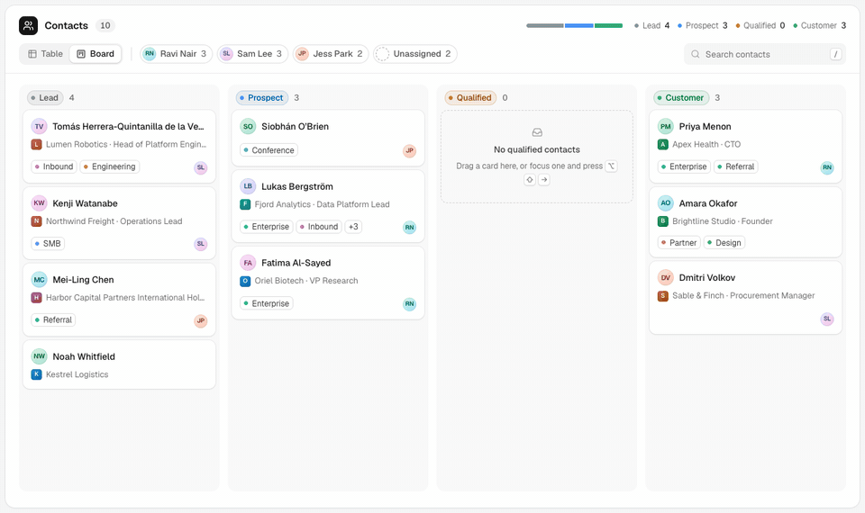
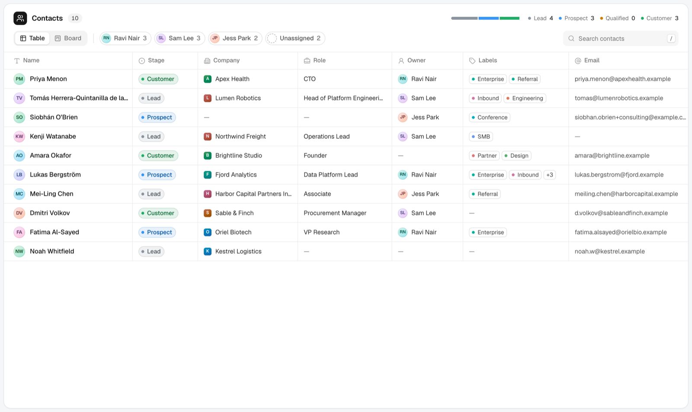
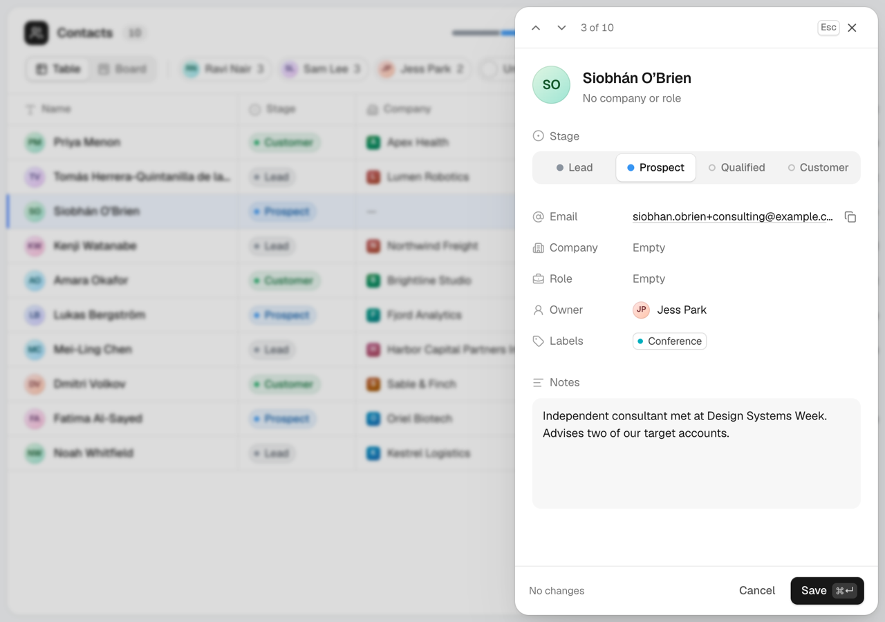

# Contacts: Table and Board

A Notion-style contacts database with two synced views of one dataset. Open anyone from the table or the board to change their Stage or Notes, then Save or Cancel. On the board you can also drag a card to a new stage.

**Live preview:** _add link after deploy_



## Run it

Requires Node 20.19 or newer.

```bash
npm install
npm run dev      # http://localhost:5173
npm test         # Vitest + Testing Library
npm run check    # lint, typecheck, tests, production build
```

## What's built

- **Table** with all eight fields, a sticky header and Name column, and cells that truncate with a tooltip.
- **Board** grouped into Lead, Prospect, Qualified and Customer. Qualified starts empty and stays visible as a drop target.
- **One details panel** for both views. Stage is a four-step control; Notes is a text area. Both stay a draft until Save.
- **Drag a card** to another column, or focus it and press ⌥⇧← / ⌥⇧→. Moves commit at once and offer Undo.
- **Search and owner filters** that apply to both views, plus a pipeline bar that tracks counts live.
- **Return to context:** after any change, focus goes back to the record, it briefly tints in its new stage colour, and a toast offers Undo.

| Table                         | Narrower desktop (1024px)                                 |
| ----------------------------- | --------------------------------------------------------- |
|  |  |

## Decisions and trade-offs

- **Two ways to change a stage, each with its own save model.** The panel is a form, so it uses an explicit Save and Cancel, as the brief asks. Dragging a card is direct manipulation, so it commits on drop with an Undo. I never mix the two inside one surface. A card whose stage has an unsaved edit can't be dragged, because a later Save would silently overwrite the drop.
- **Cancel discards immediately; implicit exits ask first.** Cancel is an explicit choice. Esc, the close button, the scrim, paging with J/K, or opening another record ask "Discard unsaved changes?", because those can be accidental. Save is never disabled; the footer says "No changes" or "Unsaved changes" instead.
- **A side panel, not a modal.** At 1280px and wider it docks beside the view, which narrows smoothly and stays clickable. Below that it overlays with a scrim and the page behind is inert.
- **Motion has a job or it doesn't happen.** Things that move explain where something went: the switcher thumb, a card travelling to its new column, counts rolling, the panel arriving from the edge. Animations are short and interruptible, and focus never animates. Under the OS reduced-motion setting, movement and resizing stop and only fades remain.
- **Kobra was the visual bar, not the source.** Its components are paid, so I rebuilt the look: tinted stage pills with a same-hue ring, hairline grids, layered shadows, filter chips that join into one track. Colour is reserved for Stage; labels only get a small dot.
- **Two libraries, for the parts that are easy to get wrong.** Motion handles shared-layout animation and reduced motion. dnd-kit handles pointer, touch and auto-scroll. Everything else is native: table, text area, the stage control as a WAI-ARIA radio group. The cost is bundle size, which grew from about 79KB to 158KB gzipped.
- **One store, derived views.** A normalized `byId` map and one `contact/updated` action. Board columns, counts, filters and paging are all derived on render, so a record can't be duplicated or left behind. The panel reads the live record and keeps only edited fields in its draft.
- **Missing values are explicit.** Tables show a dash with screen reader text such as "No email". The panel says "Empty". Text colours measure 4.5:1 or better against their backgrounds.

## Keyboard

| Key                                       | Does                                                       |
| ----------------------------------------- | ---------------------------------------------------------- |
| Tab, Enter                                | Reach a name and open its panel                            |
| ← → in the view switcher or stage control | Switch view, or pick a stage                               |
| ⌥⇧← / ⌥⇧→ on a card or row                | Move it to the previous or next stage                      |
| J / K in the panel                        | Next or previous record, in on-screen order                |
| ⌘/Ctrl + Enter                            | Save                                                       |
| Esc                                       | Close the panel, asking first if there are unsaved changes |
| /                                         | Search                                                     |
| ⌘/Ctrl + Z                                | Undo the last change while its toast is showing            |

## Left out, and what I'd do next

1. **Load the board and Motion's layout code lazily** to win back most of the extra 79KB.
2. **Put the open record in the URL** so a panel can be linked and survives reload.
3. **Reorder within a column**, which would need a per-stage position field.
4. **Persist edits** to local storage, and design a true mobile layout below 1024px.
5. **Optional interface sound** for save, drop and undo, off by default.

## Data

Ten hand-written fictional contacts using reserved `.example` domains. Each one exercises one edge case: a very long name, a long company, no email, no company or role, no owner, five labels, no labels, and empty notes.

## Time spent

_Fill in._
